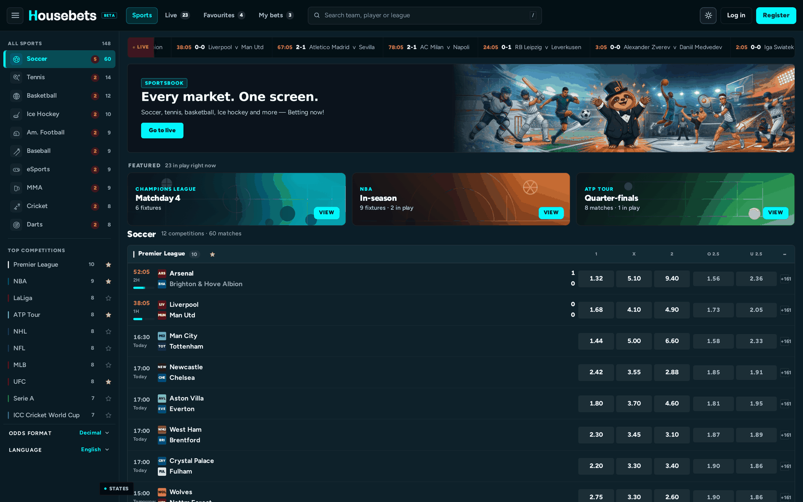
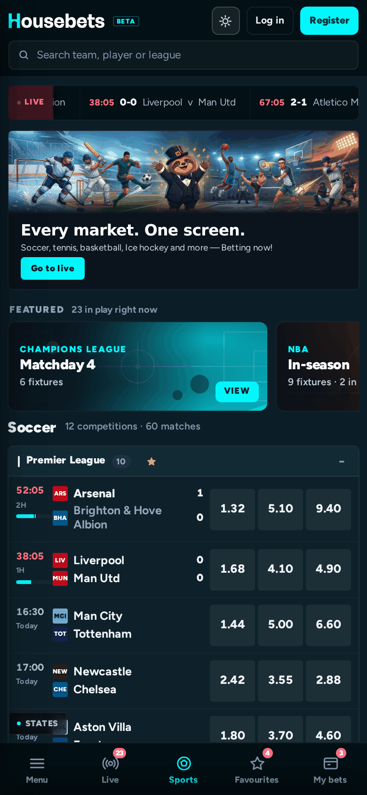
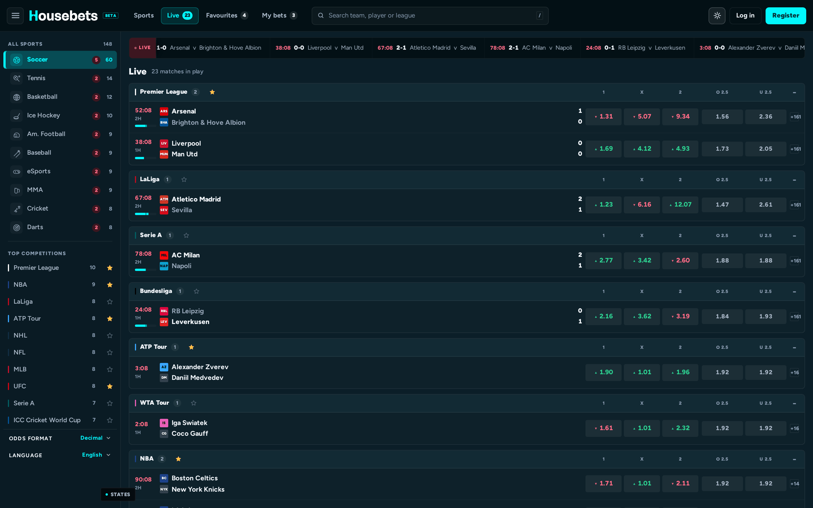
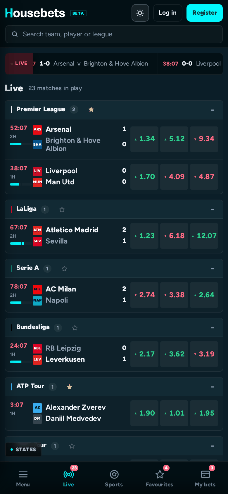
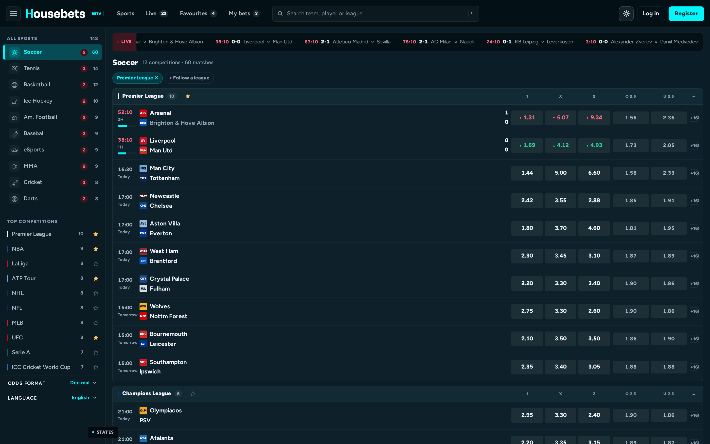
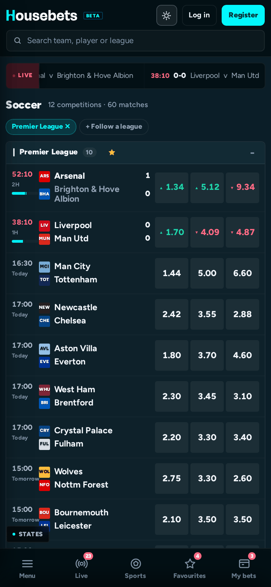
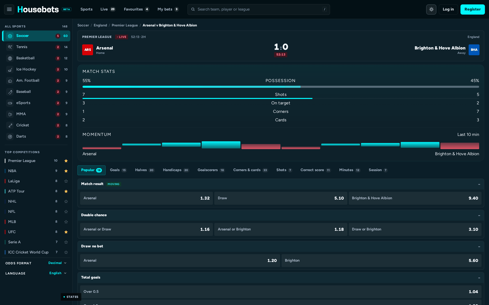
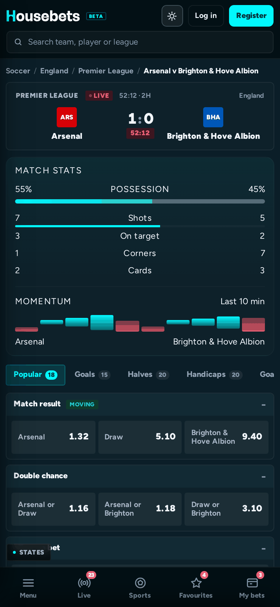
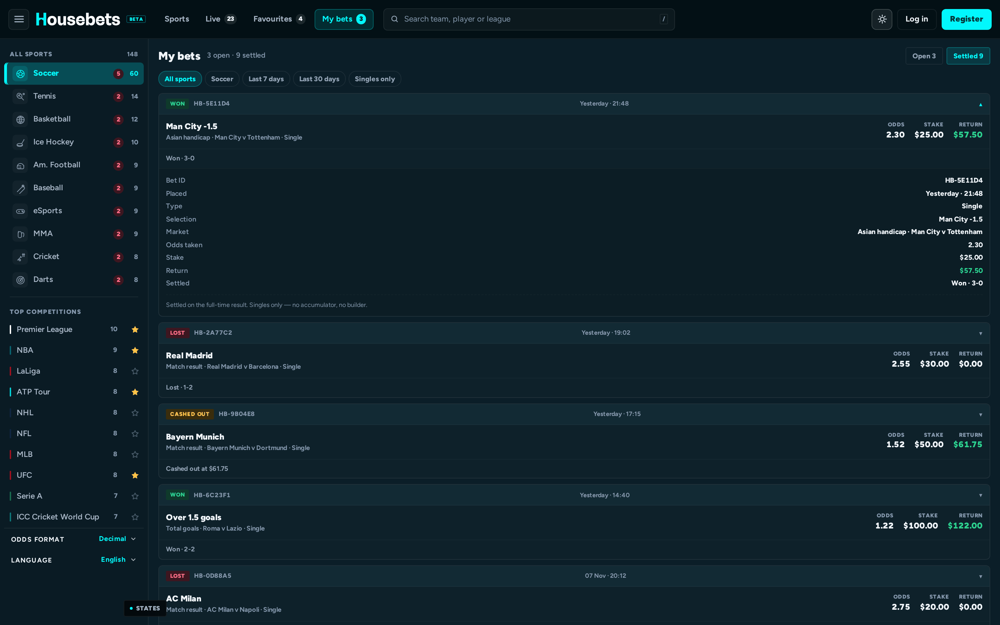
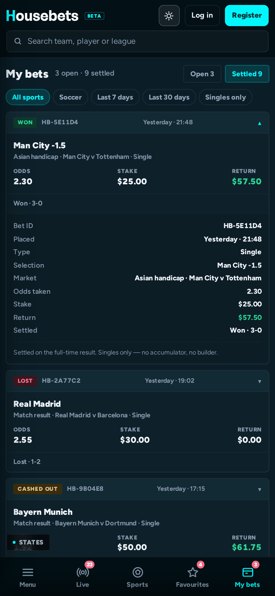

# Housebets Sportsbook

**Live prototype** — Housebets "Sportsbook is coming"

Five pages. Phone and desktop. In the Housebets shell.

 

[**biawaklangit.github.io/housebets-sportsbook**](https://biawaklangit.github.io/housebets-sportsbook/)

Single-page build · hash routing · no login · no backend

---

## What it is

A clickable sportsbook that behaves like a trading desk rather than a landing page.

| | |
|---|---|
| **Singles only** | Every selection is staked and settled on its own. No multis, no accumulators, no bet builder. |
| **Dense by design** | 56px fixture rows at 1440 (all 23 identical). At 390 the row is 57px and grows only when a club name wraps — `Brighton & Hove Albion` is the one that does. Eight above the fold at 1440×900, six at 390×844. Live clocks count in `mm:ss` and move every second. |
| **Bet slip as a column** | Opening it reflows the match grid instead of covering it. Minimising hands the width back. |
| **161 soccer selections** | Across 33 market groups and ten tabs. The deepest tab holds 33. |
| **Seven honest states** | Odds moved, suspended, placed, failed, empty, reset — each one enforced in code, not just drawn. |
| **Sample data only** | 148 fixtures across 10 sports. No real player data, no real money. |

### Against the five pages the brief asks for

| Brief | Where it is | Route |
|---|---|---|
| Sports home | Banner, live strip, ten sport chips, league-grouped fixtures | `#/home` |
| Live | 23 in-play fixtures, clocks advancing, prices flashing | `#/live` |
| Soccer | 60 soccer fixtures across 12 competitions, collapsible | `#/soccer` |
| Match page | Ten tabs, 161 selections, 33 market groups, live stats block | `#/match/ars-bha` |
| Bet slip + My bets | Slip docks as a column; tickets carry a full receipt | `#/slip` |

---

## 1 · Sports home

Live strip, banner, featured competitions, ten sport chips, fixtures grouped by league.

Each of the ten sports carries its own pictogram in the drawer — a ball, a racket, a puck, a helmet, a bat, a gamepad, a glove, a cricket bat-and-stumps, a dartboard. They were all drawing the football for a while because the icon map was keyed by sport id while the call site looked it up by icon name, so the lookup always missed and fell back to the ball. A test now asserts all ten glyphs are distinct. The banner splits on desktop — copy on its own panel, artwork unrepeated across 52% of the width. On phones it becomes a full-width band with the copy underneath, because a 4:1 crop squeezed beside the text left both halves unreadable.

That banner costs two fixture rows on the first screen: eight remain at 1440×900, six at 390×844.

### Desktop — 1440×900

### Phone — 390×844

  

---

## 2 · Live

23 in-play fixtures with clocks that count in `mm:ss` and move every second — watch for ten seconds and the number changes. The live strip above the fold carries matches only, no odds, no noise. Trend arrows and price flashes fire on every tick, so a price that moves is visibly marked rather than quietly swapped.

Every live **soccer** fixture also carries the numbers a real in-play screen shows. Tennis, MMA, basketball and the rest do not get them — possession and corners are football concepts, and a possession bar on a tennis match was a bug we removed.

- **Possession** — a 38px split bar under the clock in the fixture row, with a centre tick so you can see which side of 50% the game sits on, and the exact split in the hover title. The same figure appears as a labelled bar on the match page, and the two always agree.
- **Momentum** — ten bars for the last ten minutes, home pressure above the line, away below.
- **Match stats** — shots, on target, corners, cards, each as a home/away pair.

The figures come from the fixture id plus a slow time bucket. That means they differ per match, stay stable when you reload inside the same five-minute window, and still drift if you sit on the page. Momentum moves on a 30-second bucket. Five of the 23 live fixtures are soccer, so five rows carry a bar.

### Desktop — 1440×900

### Phone — 390×844

  

---

## 3 · Soccer

All 60 soccer fixtures across 12 competitions, grouped by league and collapsible. The heading count reads `12 competitions · 60 matches` and is counted from the filtered list, not typed. Competition chips narrow it further; the count in each header is the count of rows beneath it.

### Desktop — 1440×900

### Phone — 390×844

  

---

## 4 · Match page

Ten tabs, **161 selections across 33 market groups**. Screenshot shows **Corners & cards** priced at 1.88 / 1.92 / 1.70 / 2.10.

| Tab | Groups inside | Selections |
|---|---|---:|
| Popular | Match result, Double chance, Draw no bet, Total goals, BTTS | 18 |
| Goals | Team totals, Clean sheet, Multi-goal, Both teams 2+, Team clean sheet | 15 |
| Halves | Half time, Second half, Half time / Full time, HT/FT correct score | 20 |
| Handicaps | Asian handicap, Winning margin, Corner handicap | 20 |
| Goalscorers | Goalscorers, Player shots on target, Scorecast | 18 |
| Corners & cards | Corners, Corners by team, Cards by team, Booking points, Race to 10 corners, Most corners, Most cards | 33 |
| Shots | Shots & shots on target | 7 |
| Correct score | Correct score | 11 |
| Minutes | Minutes, Specials | 12 |
| Session | First goal, Last goal | 7 |

A live match also carries the stats block above the market tabs: possession bar, shots, on target, corners, cards, and the momentum sparkline.

Every market group lives in exactly one tab, so the column above sums to exactly **161** — what you can count on screen is what the catalogue holds. Earlier the Popular tab repeated Goals, BTTS and the handicap, and the totals added to 179 against a catalogue of 161.

Every count on a tab is derived from the catalogue at render time. `assertTabsCover()` runs at boot and logs an error if a market group exists in the data with no tab that can deliver it — the guard is wired, not decorative.

### Desktop — 1440×900

### Phone — 390×844

  

---

## 5 · My bets

Open and settled tickets, cash-out value per ticket, singles only. Tap a ticket and it expands into its own receipt: bet ID, market, odds taken, stake, return, settlement — the return coloured by outcome.

Five filters, all of them working: All sports, Soccer, last 7 days, last 30 days, singles only. A filter that cannot change the list is never rendered as clickable.

### Desktop — 1440×900

### Phone — 390×844

  

---

## Routes

| # | Page | Route | What is on it |
|---|---|---|---|
| 1 | Sports home | `#/home` | Banner, live strip, 10 sport chips, league-grouped fixtures |
| 2 | Live | `#/live` | 23 in-play fixtures with running clocks |
| 3 | Soccer | `#/soccer` | 60 soccer fixtures, 12 competitions |
| 4 | Match page | `#/match/ars-bha` | Ten market tabs, 161 selections, possession + momentum |
| 5 | My bets | `#/slip` | Open and settled singles, receipt per ticket, five filters |

Also routable: `#/sport/<id>` for a single sport, `#/league/<id>` for a competition drill-down, `#/favourite`. Back and forward work on all of them — a drill-down that used to leave the screen blank now restores the previous page.

---

## States

Each state is verified by what the player sees and what the prototype refuses to do.

| State | What the player sees | What the prototype enforces |
|---|---|---|
| **Odds moved** | Old price struck through, `Accept` button, toast naming both prices | Staking blocked until the new price is accepted |
| **Suspended** | Selection dimmed, toast names it, prices read `—` | Staking blocked; the selection stays so it can be removed |
| **Bet placed** | Slip empties, ticket appears in My bets stamped *Just now* | Bet recorded, open count increments |
| **Bet failed** | `Bet not accepted` plus *"Nothing was taken from your balance"* | No ticket created, slip preserved for a retry |
| **Empty slip** | Empty-state copy, place button hidden | Nothing to place |
| **Stake missing** | Button dimmed and desaturated, hint reads *Every single needs a stake* | Place is disabled, not silently dead |

Two of these fire with no helper at all. Leave a live selection in the slip and the price moves on the next tick — **Odds moved** appeared on its own at 4.5 seconds in a measured run. Place a bet and **Bet placed** follows in under a second.

A `STATES` panel in the bottom corner triggers all seven on demand, for a reviewer who wants a specific one immediately instead of waiting for the ticker. It calls the same `place()`, `toast()` and suspension code the product uses; only the trigger is a shortcut. The panel stays put when you use it, so triggers can be fired in any order.

Only one message is ever on screen. Toasts used to stack with a 4.2-second life each, which meant a successful bet showed *Bet placed* underneath a still-live *Added to bet slip* for two seconds — the last thing on screen after a winning action was the wrong message. A new message now replaces the old one.

66 behavioural assertions run across both breakpoints and 360px, zero failures.

---

## Odds

Decimal by default. American, Hong Kong, Indonesian, Malaysian and Fractional switch from the side panel on desktop and from the drawer on mobile. One formatter drives every price on screen — change it and every row, every slip line and every receipt follows.

---

## Shell

Top bar, left rail, right panel — the Housebets shell from the starter files. The theme toggle sits beside the balance slot. Light and dark both pass a contrast check with zero failing elements across every rendered component.

---

## Notes

- Breadcrumbs name the real sport of the fixture — a tennis match reads `Tennis / World / ATP Tour`, not `Football`. `#/soccer` is the canonical hash; the old `#/football` still resolves to it.
- Front end only. No account, no login, no backend, no network calls at runtime.
- All fixtures and prices are generated sample data.
- Built and tested against the Housebets shell and brand pack from the starter files.
- Zero runtime dependencies. No build step required to open it.

---

Contest entry · Housebets "Sportsbook is coming" · <a href="https://x.com/bangfanji">@bangfanji</a>

